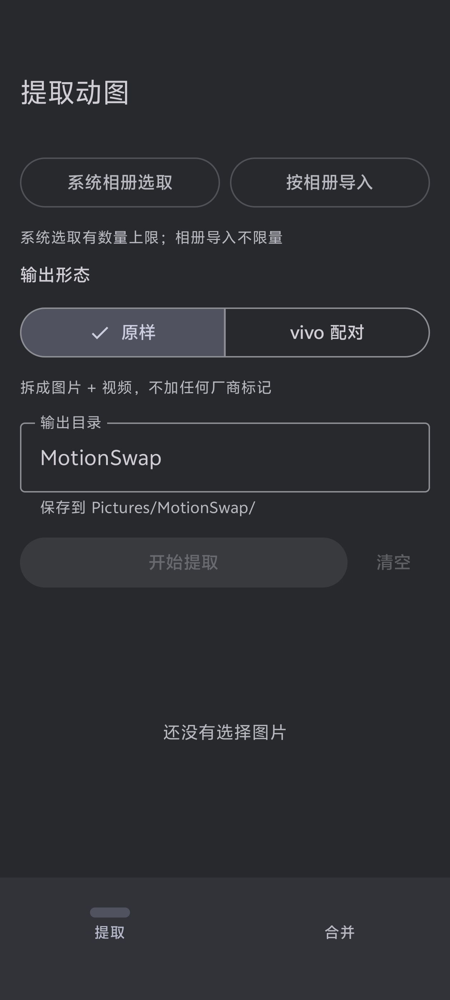
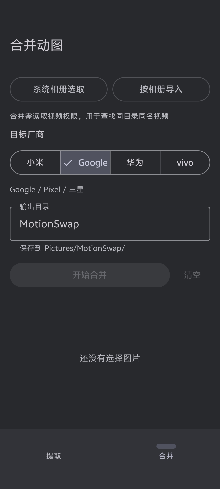

# MotionSwap

在两种「动态图片 / motion photo」的存储形态之间互转的 Android 应用。

- **提取** — 嵌入式动图（JPEG 后面直接拼接一段 MP4）→ 同名 `.jpg` + 同名 `.mp4` 两个独立文件
- **合并** — 同目录下、同名的 `.jpg` + `.mp4` → 目标厂商格式的嵌入式动图

厂商之间格式不统一，这正是这个工具存在的理由：

| 厂商 | 布局 |
|---|---|
| 小米 / 微信 | JPEG 后拼接 MP4，偏移写在 XMP 的 `GCamera:MicroVideoOffset` |
| Google / Pixel / 三星 | JPEG 后拼接 MP4，偏移写在 `GContainer` 容器指令里 |
| 华为 | 完全不带 XMP，只能靠扫描 MP4 的 `ftyp` box 特征定位 |
| vivo / iQOO | JPEG 后拼接 MP4，外加一个 `uuid` 尾盒描述主图与视频的边界 |

## UI 展示

<table align="center">
  <tr>
    <td align="center" width="50%">
      
      <br />
      <sub><b>提取界面</b></sub>
    </td>
    <td align="center" width="50%">
      
      <br />
      <sub><b>合并界面</b></sub>
    </td>
  </tr>
</table>

## 为什么不用现成工具

合并时的图片字节是**逐字节保留**的：只增删 XMP 的 APP1 段，像素数据不重编码。无损、快，代价是得自己实现 JPEG 段操作和每家的偏移语义——这部分就是 `core/` 里的大部分代码。

## 特性

- 字节级无损合并，像素不重编码
- 四种厂商格式的识别与写入
- 流式处理，单个动图数十 MB 也不会把整个文件读进内存
- 输出走标准 `RELATIVE_PATH`，系统相册自动索引，不需要额外存储权限
- `core/` 无任何 Android 依赖，332 项 JVM 测试覆盖全部厂商路径

## 架构

单一 `:app` 模块，核心原则是**字节算法与 Android API 完全解耦**：

```
core/            纯 Kotlin，无 android.* 导入，可在 JVM 上直接验证
├─ xmp/          XMP 定位与构造、JPEG APP1 段读写、Exif tag 700 镜像
├─ motion/       厂商识别、Mp4BoxScanner、流式合并
└─ model/        字节布局、兄弟文件配对规则、MediaStore 时间模型

data/            MediaStore 查询与写入
task/            协程池、进度 StateFlow、取消
ui/              Compose 界面
```

`core/` 里不出现 `android.util.Log` 是一条被测试强制的约束，不是约定：新增一个 Android 依赖会直接让 JVM 测试编译失败。这比 Robolectric 的 setup 开销低得多，而且它拦住的是"本来就不该出现在这一层"的依赖。

## 构建

需要 JDK 11+ 和 Android SDK（`compileSdk` 37）。SDK 路径写在 `local.properties`，该文件不入库。

```bash
./gradlew assembleDebug        # 调试包
./gradlew assembleRelease      # 发布包（R8 + 资源压缩）
./gradlew testDebugUnitTest    # 全部单元测试
```

测试样本在 `samples/`，缺失时相关用例会 skip 而不是 fail，所以 clone 后不带样本也能跑通。

## 发布到 GitHub Releases

仓库里没有 CI 工作流，发布是本地手工流程：

```bash
./gradlew clean assembleRelease
gh release create v1.0.0 app/build/outputs/apk/release/app-release.apk \
  --title "MotionSwap 1.0.0" --notes "见提交记录"
```

若想让打 tag 时自动签名并创建 Release，可以补一个 GitHub Actions 工作流，凭据从 Actions secrets 读取。

## 参考与致谢

本项目的字节级格式分析参考了
[MotionPhotoConverter](https://github.com/Igloo302/MotionPhotoConverter)
提供的厂商格式实现，感谢原作者公开这份格式知识。
